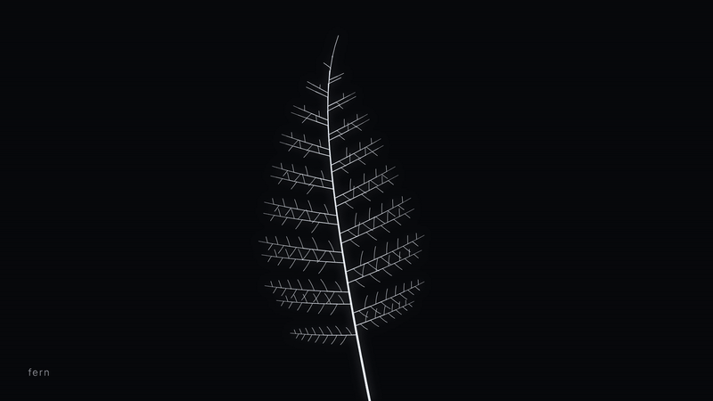

# one rule

A 45-second film where one line, following one rewriting rule, becomes a tree, a fern, lightning, a river delta, lungs and a forest. Everything is drawn and synthesized in code.



Full video: [`output/one-rule.mp4`](output/one-rule.mp4) (1080p, 60 fps, 45 s, with sound)

## The rule

```
X(n) → F(n) [ X(n−1) ] [ X(n−2) ]
```

Read it as: *every branch `F` keeps going (the first bracket) and throws off one smaller side branch (the second bracket).* Start from `X(22)`, apply the rule until nothing is left to rewrite, and you get a branching structure of 46,367 segments. That count is a Fibonacci number minus one, because each branch spawns copies of itself one and two steps smaller.

## How one rule becomes six things

Nothing is swapped out between scenes: there is only ever this one structure. Each scene is a different *layout* of the same segments, meaning a different angle, length and thickness for each one. A segment a scene doesn't need shrinks to a point and waits to grow back later. To move from one scene to the next, each segment's angle, length and width blend toward their new values. The change starts at the root and travels out to the tips, so you watch the same branches bend into a new shape rather than see a cut.

| scene | what the layout does |
| --- | --- |
| **tree** | Branches alternate sides and get shorter and thinner the further they are from the trunk. They lean a little toward the light. The first scene grows one generation at a time from a single line. |
| **fern** | The main axis becomes the stem. Side branches become pinnae in staggered pairs inside a narrow, pointed outline, and their own side branches become pinnules. |
| **lightning** | The main axis becomes a jagged channel that wanders as it falls. Side branches are kept or dropped at random, more often dropped the further they are from the main channel. |
| **river delta** | Seen from above. One meandering river reaches an apex, then splits again and again. Channels head toward their own stretch of coast, split at about 70°, and get narrower as the water divides. |
| **lungs** | Each airway points at the middle of the patch of lung it has to supply. That patch is then cut in two and shared between its two children. The first split follows anatomy: the right bronchus is short and steep, and the left is longer and flatter to clear the heart. |
| **forest** | The structure lies flat as hidden runners across the ground, and every side branch stands up as a tree, smaller with distance. The camera starts inside one crown and pulls back to show the whole forest at dusk. Like an aspen grove, it is all one organism. |

## How the music is made

There are no audio files. The soundtrack is rendered offline with the Web Audio API from oscillators, noise and arithmetic:

- **Pad:** one chord per scene, tuned in just intonation (whole-number frequency ratios over A = 110 Hz). Each chord is played by slightly detuned sawtooth waves through a low-pass filter that slowly opens and closes.
- **Plucks:** [Karplus–Strong](https://en.wikipedia.org/wiki/Karplus%E2%80%93Strong_string_synthesis) strings. A burst of noise circulates in a short delay line that averages and decays. One plays each time a generation of branches splits while the tree grows, and as each change ripples outward during a transition.
- **Thunder and breath:** filtered noise. Low brown noise follows each lightning flash, and a soft band-passed breath follows the rhythm of the lungs.
- **Room:** a reverb whose impulse response is itself generated from decaying noise.
- **Master:** loudness-normalized to −14 LUFS integrated with a −1.5 dBFS ceiling (EBU R128, measured with ffmpeg).

## Run it

Requires Node 22, pnpm and ffmpeg.

```sh
pnpm install
pnpm dev            # open http://localhost:5173/?play for a real-time preview with sound
                    # or /?frame=1850 to look at a single frame
pnpm render         # → output/one-rule.mp4
pnpm frames 690 1850   # render chosen frames to build/stills/
```

`pnpm render` builds the page with Vite and opens it in headless Chromium through Playwright. It then:

1. Draws every frame from its frame number alone (no clock, no randomness at run time), so the same code always produces the same video.
2. Saves the frames losslessly, using several browser pages in parallel.
3. Renders and masters the audio.
4. Does one two-pass H.264 encode sized to fit under GitHub's file limit (`TARGET_MB`, default 96).

## Checking the shapes against real measurements

Frames from the finished video were checked against published measurements of each subject. [`scripts/measure.ts`](scripts/measure.ts) reads the numbers directly from the layouts. The "before" column is the first render; "after" is this version.

| scene | what was measured | before | after | published reference |
| --- | --- | --- | --- | --- |
| lightning | average change of direction along the main channel | 15.0° | 24.3° | ~26° in natural ground flashes¹ |
| river delta | angle between the two channels at each split | ~20–30° | 72.3° (31 splits) | ~70° mean over 64 splits in an experimental delta² |
| lungs | angle of main bronchi from vertical, right / left | ~40° / ~40° | 25° / 45° | ~25° / ~45°³ |
| lungs | length of left vs right main bronchus | ~1× | 2× | ~5 cm vs ~2.5 cm³ |
| lungs | thin airways crossing the heart | several | 0 | none |
| fern | pinnae on the frond | ~15, all one per node | 31, staggered pairs | 15–50 pinnae⁴, mostly alternate⁵ |

Sources:

1. [High-speed photographic studies of lightning channel tortuosity](https://archive.cmb.ac.lk/items/e1c32e29-4a5c-4f01-955e-9a19748c9546) (University of Colombo)
2. [Role of unchannelized flow in determining bifurcation angle in distributary channel networks](https://agu.confex.com/agu/os16/preliminaryview.cgi/Paper91395.html) (AGU Ocean Sciences 2016), and [Edmonds & Slingerland 2007](https://ftp.ems.psu.edu/data/pub/geosc/sling/PUBLICATIONS_SLINGERLAND/2001-2010/Edmondsetal2007.pdf) on channels narrowing with each split
3. [Radiopaedia: main bronchus](https://radiopaedia.org/articles/main-bronchus); [The Common Vein: right mainstem bronchus](https://thecommonvein.com/lungs/000-right-mainstem-bronchus/)
4. [USFWS: *Diellia erecta*](https://www.fws.gov/species/asplenium-leaf-diellia-diellia-erecta)
5. [USPTO PP4257](https://image-ppubs.uspto.gov/dirsearch-public/print/downloadPdf/PP4257); [JSTOR Global Plants: *Asplenium pellucidum*](https://plants.jstor.org/compilation/Asplenium.pellucidum)

Limits:

- The delta is still a tree. Real deltas have channels that rejoin around islands, and a single branching rule can't make loops.
- The fern is at the low end of the reference range because the rule allows only 22 nodes along the stem.
- These checks used published measurements, not side-by-side photos, because the build environment couldn't download images.

Full notes are in [CRITIC.md](CRITIC.md).

## Layout

```
src/lsystem.ts     the rule, rewriting, and the resulting tree
src/forms.ts       the six layouts
src/render.ts      morphing, camera, colour and drawing (Canvas 2D)
src/audio.ts       the soundtrack (Web Audio, OfflineAudioContext)
src/timeline.ts    shared timing for picture and sound
scripts/render.ts  frame-by-frame render and encode
scripts/measure.ts the measurements in the table above
```
